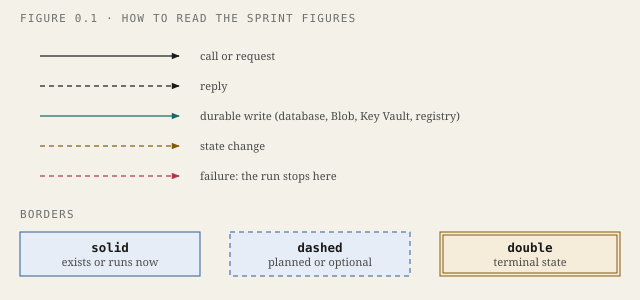
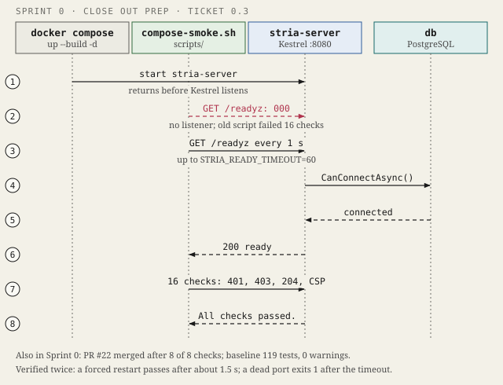
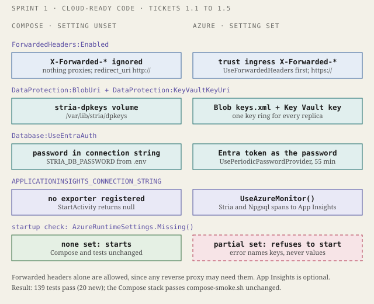
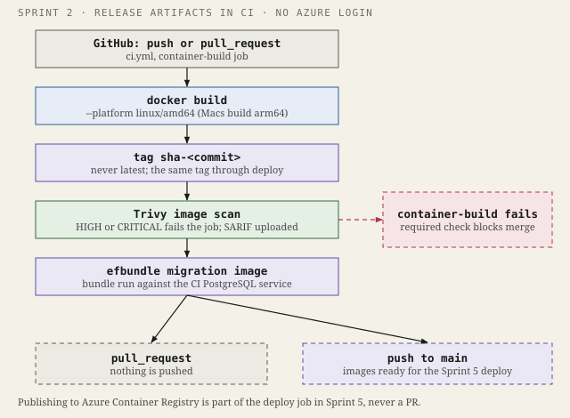
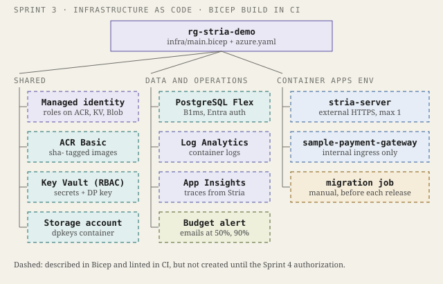
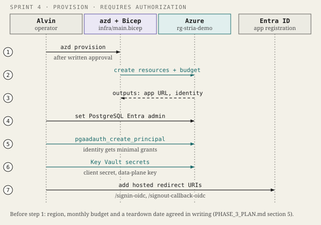
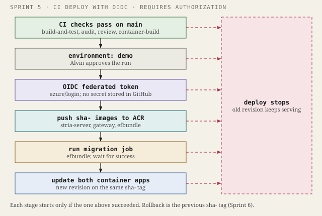
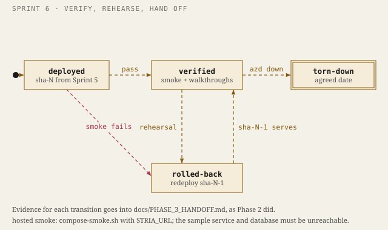

# Phase 3 Sprints, in Figures

One figure per sprint of [PHASE_3_PLAN.md](PHASE_3_PLAN.md). **Status (2026-11-23):** Sprints 0–4 are
done. Sprints 0–3 are #23–#30 (see the plan's Step 3 progress table). Sprint 4 provisioned the hosted
demo after the written authorization on 2026-11-21 (see the plan's Step 4 progress table, and #38–#40
for the fixes it needed). Sprint 5 is in progress: 5.0–5.2 are done (#42–#47), and since 2026-11-23 every push to `main`
deploys through CI after approval; 5.3 and 5.4 remain (see the plan's Step 5 progress table).
Sprint 6 remains.

The figures are built by `node docs/figures/src/phase-3-sprints.mjs`. Edit the script, not the SVGs.

**Colours mean the same thing in every figure:**

| Hue | Meaning |
|---|---|
| Rose | Failure: the run stops or startup is refused |
| Grey | Outside Stria: GitHub, Docker, Entra ID, the operator |
| Amber | Lifecycle: jobs and revision states |
| Teal | Durable state: PostgreSQL, Blob, Key Vault, the registry |
| Blue | Stria host behaviour: stria-server and its container apps |
| Violet | Configuration and build artifacts: settings, image tags, Bicep |
| Green | Verification: checks, scans, smoke tests |
| Indigo | Observability: logs and traces |
| Olive | Effects outside Stria, such as budget emails |

**The legend shows each arrow and border style the set uses.** Read top to bottom.

## Sprint 0 — Close out prep (done)

**compose-smoke.sh now waits for /readyz, so a run straight after `docker compose up -d` no longer
fails with 000.** Read top to bottom; numbers give the order. Source: `scripts/compose-smoke.sh` and
the 2026-11-18 baseline run.

## Sprint 1 — Cloud-ready code (PR #23, green)

**One image runs locally and in Azure. Each setting picks the behaviour, and a partial Azure set
refuses to start.** Read each row from left (Compose) to right (Azure). Source: `Program.cs`,
`Security/DataProtectionSetup.cs`, `Data/StriaDataSource.cs`, `Security/AzureRuntimeSettings.cs` and
`Services/StriaTelemetry.cs`.

## Sprint 2 — Release artifacts in CI (PR #24, green)

**Every commit becomes amd64 images tagged with its SHA, scanned by Trivy, plus a tested
migration bundle. Nothing is pushed from a PR.** Read top to bottom. Source: the `container-build`
job in `.github/workflows/ci.yml` and the `bundle`/`migrator` stages of `Stria.API/Dockerfile`.

## Sprint 3 — Infrastructure as code (done)

**Bicep describes every Azure resource before any of them exists, so their cost and access can be
reviewed first.** Read from the resource group down. Dashed borders mean planned, not created.
Source: PHASE_3_PLAN.md, section 3. Every module is in `infra/`: identity, monitoring, registry, Key Vault,
storage, PostgreSQL, the environment, both apps, the migration job and the budget. CI checks them
in the required `infra-validate` job. The
sprint opens with a `Program.cs` refactor (ticket 3.0) that the figure doesn't show.

## Sprint 4 — Provision (done)

**Provisioning starts only after written approval. The one-time steps give the managed identity
database access, store secrets in Key Vault, and register the hosted redirect URIs.** Read top to
bottom. Source: PHASE_3_PLAN.md, Step 4.

## Sprint 5 — CI deploy with OIDC (requires authorization)

**The deploy job uses OIDC instead of stored secrets, and stops at the first failing stage, so the
running revision keeps serving.** Read top to bottom; each red arrow is a stage failing. Source:
PHASE_3_PLAN.md, Step 5.

## Sprint 6 — Verify and hand off

**A hosted revision must pass the smoke test and the role walkthroughs, survive one rollback
rehearsal, and is torn down on an agreed date.** Read left to right from the dot; the double border
is the final state. Source: PHASE_3_PLAN.md, Step 6.
